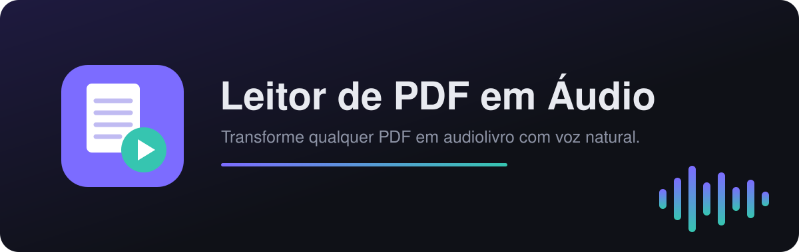
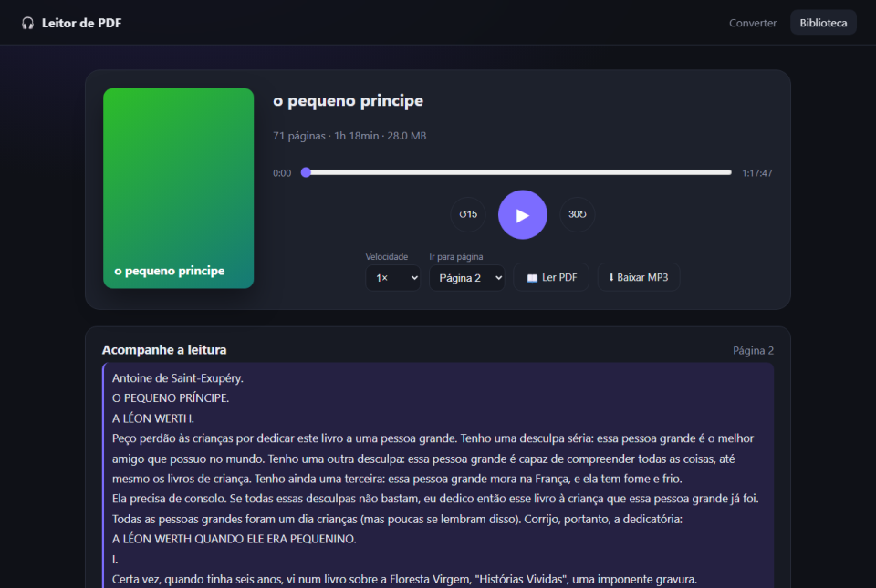
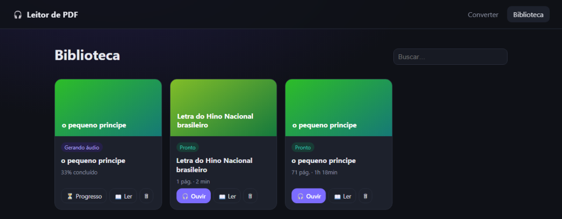
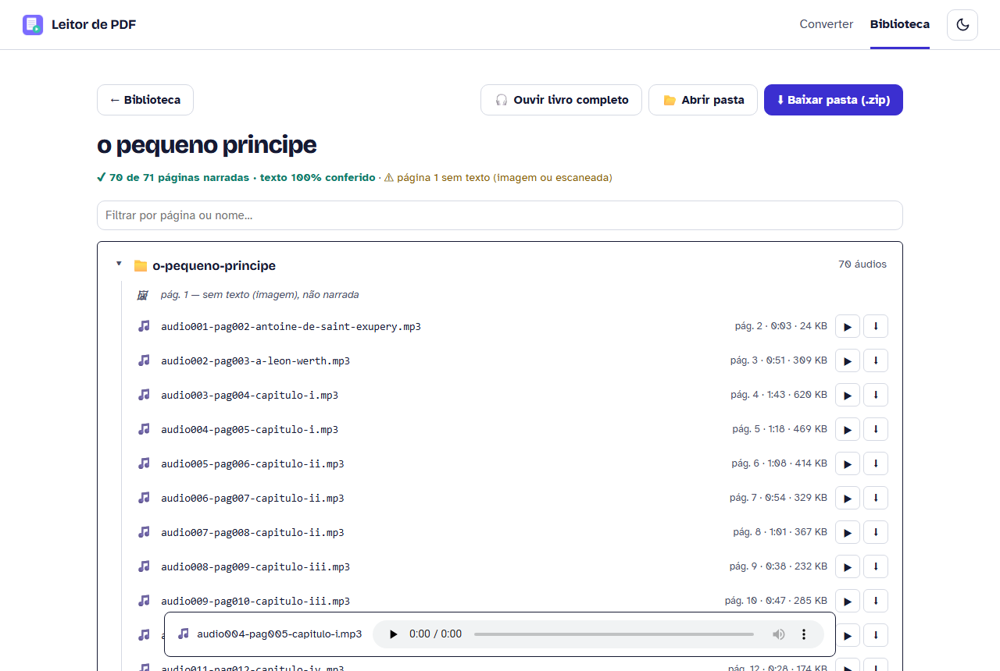

<div align="center">



<br />
<br />

**Transforme qualquer PDF em audiolivro, com voz natural, sem palavras cortadas e sem limite de tamanho.**

<br />

<a href="https://github.com/valnasio/PDF-TO-AUDIO-CONVERTER/releases/latest/download/LeitorPDF.exe"></a>
&nbsp;
<a href="https://github.com/valnasio/PDF-TO-AUDIO-CONVERTER/releases/latest/download/leitor-pdf_amd64.deb"></a>
&nbsp;
<a href="https://github.com/valnasio/PDF-TO-AUDIO-CONVERTER/releases/latest/download/leitor-pdf.x86_64.rpm"></a>
&nbsp;
<a href="https://github.com/valnasio/PDF-TO-AUDIO-CONVERTER/releases/latest/download/leitor-pdf.flatpak"></a>
&nbsp;
<a href="https://valnasio.github.io/PDF-TO-AUDIO-CONVERTER/app/"></a>

<br />
<br />

<sub>Não precisa instalar nada · <a href="https://valnasio.github.io/PDF-TO-AUDIO-CONVERTER/">Página do projeto</a></sub>

<br />
<br />

<a href="https://github.com/valnasio/PDF-TO-AUDIO-CONVERTER/releases"></a>
<a href="https://github.com/valnasio/PDF-TO-AUDIO-CONVERTER/releases"></a>


</div>

---

## 📖 Descrição

O **Leitor de PDF em Áudio** converte documentos PDF em audiolivros narrados por vozes neurais em português. O programa tem uma biblioteca onde você pode **ouvir** o áudio ou **ler** o PDF original, e o texto acompanha a narração em tempo real.

<p align="center">
  
</p>

## 🕰️ A história do projeto

Este projeto nasceu há cerca de 4 anos, inspirado por um vídeo do canal **Hashtag Programação** no YouTube, que mostrava como transformar o texto de uma variável em áudio. Tive a ideia de aplicar isso à leitura de PDFs: extrair o texto do documento e entregá-lo ao leitor de voz.

A primeira versão foi escrita inteiramente à mão. Era um script de poucas linhas usando `gTTS` e `PyPDF2`: bastava colocar o PDF na pasta, trocar o nome do arquivo no código e rodar. Funcionava, mas tinha limitações que eu não consegui resolver na época:

- **PDFs grandes não funcionavam bem.** O texto era cortado em blocos fixos de caracteres, o que quebrava palavras e frases no meio. Livros inteiros geravam centenas de arquivos soltos, um por página.
- A voz era **robotizada** e a entonação ficava estranha em títulos, cabeçalhos e números de página.
- Era preciso **saber programar** para usar, além de instalar o FFmpeg manualmente.

O projeto ficou parado nesse ponto. Com a chegada das ferramentas de IA, voltei a ele para destravar justamente o que tinha ficado pendente, principalmente o **suporte a PDFs grandes**, e aproveitei para transformar o script num aplicativo que qualquer pessoa consegue usar.

| | Versão original (manual) | Versão atual |
|---|---|---|
| **PDFs grandes** | Cortes fixos de 9.999 caracteres, palavras quebradas | Divisão só entre frases e parágrafos, milhares de páginas |
| **Voz** | gTTS (robotizada) | Vozes neurais naturais (Francisca, Antônio, Thalita…) |
| **Resultado** | MP3 soltos, sem nome | Um áudio por página, numa pasta com o nome dos capítulos, e o livro completo |
| **Texto faltando** | Sem verificação | Cada trecho é conferido e refeito se faltar algo |
| **Interrupções** | Recomeçava do zero | Continua de onde parou |
| **Como usar** | Editar o código e rodar no terminal | Dois cliques no `.exe` |
| **Dependências** | Python + FFmpeg | Nenhuma |

## ✨ Funcionalidades

<table>
  <tr>
    <td width="50%"></td>
    <td width="50%"></td>
  </tr>
  <tr>
    <td><b>📤 Envio:</b> arraste o PDF, escolha a voz e ouça uma amostra antes de converter.</td>
    <td><b>⏳ Conversão:</b> acompanhe cada etapa, o percentual e o tempo restante.</td>
  </tr>
  <tr>
    <td width="50%"></td>
    <td width="50%"></td>
  </tr>
  <tr>
    <td><b>🎧 Player:</b> velocidade de 0.75× a 2×, ir para página, texto acompanhando a narração, continuar de onde parou e baixar o MP3.</td>
    <td><b>📚 Biblioteca:</b> todos os seus arquivos, com busca e progresso de escuta. Ouça o livro completo, abra a pasta com um áudio por página (ex.: <code>o-pequeno-principe/audio004-pag005-capitulo-i.mp3</code>), baixe tudo em .zip ou leia o PDF.</td>
  </tr>
</table>

<p align="center">
  <br />
  <sub><b>📁 Áudios por página:</b> cada página vira um MP3 com o nome do capítulo, numa pasta por livro. Ouça, baixe uma página ou a pasta inteira em .zip.</sub>
</p>

<p align="center"><sub>Todas as telas têm modo claro e noturno.</sub></p>

## 🚀 Como usar

Escolha a versão que preferir:

| | 🪟 Windows | 🐧 Linux | 🌐 Mini (web) |
|---|---|---|---|
| **Download** | [`LeitorPDF.exe`](https://github.com/valnasio/PDF-TO-AUDIO-CONVERTER/releases/latest/download/LeitorPDF.exe) (~36 MB) | [`.deb`](https://github.com/valnasio/PDF-TO-AUDIO-CONVERTER/releases/latest/download/leitor-pdf_amd64.deb) · [`.rpm`](https://github.com/valnasio/PDF-TO-AUDIO-CONVERTER/releases/latest/download/leitor-pdf.x86_64.rpm) · [`.flatpak`](https://github.com/valnasio/PDF-TO-AUDIO-CONVERTER/releases/latest/download/leitor-pdf.flatpak) (~40 MB) | [Abrir no navegador](https://valnasio.github.io/PDF-TO-AUDIO-CONVERTER/app/) |
| **Gera MP3** | ✅ | ✅ | ❌ lê em voz alta na hora |
| **Vozes** | Neurais (Francisca, Antônio, Thalita…) | Neurais | Naturais no aparelho (Faber, Cadu, Jeff), em qualquer navegador |
| **Interface** | Janela própria | Janela própria | Navegador, inclusive no celular |
| **Seus PDFs ficam** | No computador | No computador | No navegador (nada é enviado) |

### 🪟 Windows

1. **[Baixe o `LeitorPDF.exe`](https://github.com/valnasio/PDF-TO-AUDIO-CONVERTER/releases/latest/download/LeitorPDF.exe)**.
2. Dê dois cliques. O programa abre em uma janela própria.
3. Arraste um PDF, escolha a voz e clique em **Converter em áudio**.

> [!NOTE]
> Na primeira execução, o Windows pode exibir **"O Windows protegeu o computador"**. Clique em **Mais informações → Executar assim mesmo**. Isso acontece com programas que não têm assinatura digital paga.

### 🐧 Linux

Baixe o pacote do seu sistema e abra com dois cliques (a Central de Programas instala tudo):

- **Ubuntu, Debian, Mint, Pop!_OS:** [`leitor-pdf_amd64.deb`](https://github.com/valnasio/PDF-TO-AUDIO-CONVERTER/releases/latest/download/leitor-pdf_amd64.deb)
- **Fedora:** [`leitor-pdf.x86_64.rpm`](https://github.com/valnasio/PDF-TO-AUDIO-CONVERTER/releases/latest/download/leitor-pdf.x86_64.rpm)
- **Qualquer outra distribuição:** [`leitor-pdf.flatpak`](https://github.com/valnasio/PDF-TO-AUDIO-CONVERTER/releases/latest/download/leitor-pdf.flatpak) (veja abaixo)

Ou pelo terminal:

```bash
sudo apt install ./leitor-pdf_amd64.deb      # Ubuntu / Debian
sudo dnf install ./leitor-pdf.x86_64.rpm     # Fedora
```

Depois procure **"Leitor de PDF em Áudio"** no menu de aplicativos. O programa abre em janela própria (GTK + WebKitGTK, instalados automaticamente como dependências).

#### Flatpak (qualquer distribuição)

1. **Tenha o Flatpak instalado.** Fedora, Linux Mint e Pop!_OS já vêm prontos. No Ubuntu, rode uma vez e reinicie o computador:
   ```bash
   sudo apt install flatpak gnome-software-plugin-flatpak
   flatpak remote-add --if-not-exists flathub https://dl.flathub.org/repo/flathub.flatpakrepo
   ```
2. **Baixe** o [`leitor-pdf.flatpak`](https://github.com/valnasio/PDF-TO-AUDIO-CONVERTER/releases/latest/download/leitor-pdf.flatpak).
3. **Dê dois cliques** no arquivo e clique em Instalar na loja de aplicativos. Ou, no terminal, na pasta Downloads:
   ```bash
   flatpak install --user leitor-pdf.flatpak
   ```
4. A primeira instalação baixa os componentes do GNOME (cerca de 1 GB), que ficam compartilhados com outros apps Flatpak.
5. Abra pelo menu ("Leitor de PDF em Áudio") ou com `flatpak run io.github.valnasio.LeitorPDF`.

### 🌐 Mini (web)

Abra **[valnasio.github.io/PDF-TO-AUDIO-CONVERTER/app](https://valnasio.github.io/PDF-TO-AUDIO-CONVERTER/app/)**, arraste o PDF e clique em ▶. O PDF nunca sai do seu aparelho.

- **Vozes naturais grátis em qualquer navegador** (Chrome, Edge, Firefox, Safari): Faber, Cadu e Jeff, vozes neurais do projeto [Piper](https://github.com/rhasspy/piper) geradas no próprio aparelho com WebAssembly. Cada voz é baixada uma única vez (63 MB) e fica guardada no navegador.
- No Microsoft Edge, também dá para escolher as vozes da Microsoft.
- Se a voz natural não puder ser usada (navegador antigo, por exemplo), o player passa sozinho para a voz do navegador.

### Bom saber

- Nas versões Windows e Linux, é preciso estar **conectado à internet durante a conversão**, porque as vozes são geradas online. Depois de convertido, o áudio pode ser ouvido sem internet.
- **Os áudios ficam na sua pasta de música**, em `PDFAudioConvert`, com uma subpasta por livro: `Músicas\PDFAudioConvert` no Windows e `~/Música/PDFAudioConvert` no Linux (inclusive no Flatpak). O botão **Abrir pasta** leva direto até ela.
- **Dá para ouvir durante a conversão:** cada página fica disponível assim que termina, sem esperar o livro inteiro.
- Os dados internos do programa (biblioteca e PDFs) ficam em `%LOCALAPPDATA%\LeitorPDF` (Windows) ou `~/.local/share/LeitorPDF` (Linux).
- Se o programa for fechado durante uma conversão, ela continua de onde parou na próxima vez que for aberto.

## 🧠 Como garantimos a qualidade

| Problema | Solução |
|---|---|
| Voz robótica | Vozes neurais da Microsoft via [`edge-tts`](https://github.com/rany2/edge-tts) |
| Palavras cortadas | O texto só é dividido entre parágrafos e frases. A hifenização de fim de linha é desfeita ("pala-/vra" → "palavra", mantendo "disse-lhe") e parágrafos que continuam na página seguinte são unidos |
| Palavras faltando | O serviço informa cada palavra falada e o app confere se o áudio não terminou antes da última palavra. Trecho incompleto é refeito; se continuar incompleto, é refeito frase a frase. Se uma frase não puder ser lida, a conversão pausa com erro (nunca pula texto em silêncio) |
| Páginas sem leitura | Cada frase fica inteira na página em que começa, e cada página vira um áudio. Ao final, um relatório mostra quantas páginas foram narradas e quais não têm texto (imagens ou páginas escaneadas) |
| Conversões longas | No Windows, o computador não entra em suspensão enquanto há conversão em andamento |
| Entonação estranha | Cabeçalhos, rodapés e números de página são removidos. Títulos ganham pausa e travessões de diálogo viram pausas |
| PDFs enormes | Extração página a página, trechos salvos em disco, síntese em paralelo e montagem do áudio em streaming. Um PDF de 2.130 páginas é lido em ~2 segundos |

## 🛠️ Para desenvolvedores

Requer Python 3.10+. Não precisa de FFmpeg.

```bash
python -m venv .venv
.venv\Scripts\activate
pip install -r requirements.txt
python main.py             # abre a janela do aplicativo
python main.py --browser   # abre no navegador
```

Opções: `--port 9000`, `--host 0.0.0.0 --browser` (acesso pela rede).

Variáveis de ambiente opcionais:

- `PDF_AUDIO_OUTPUT`: pasta onde ficam os áudios (padrão no executável: `Músicas/PDFAudioConvert`)
- `PDF_AUDIO_DATA`: pasta da biblioteca (padrão: `./data`; no executável, `%LOCALAPPDATA%\LeitorPDF` ou `~/.local/share/LeitorPDF`)
- `TTS_CONCURRENCY`: trechos sintetizados em paralelo (padrão: 6)

### Gerar os executáveis

```bash
.\build.ps1      # Windows: cria dist\LeitorPDF.exe
./build.sh       # Linux:   cria dist/leitor-pdf_amd64.deb e dist/leitor-pdf.x86_64.rpm
```

Ao publicar uma tag `v*` (ex.: `git tag v2.1.0 && git push origin v2.1.0`), o GitHub Actions gera o `.exe`, o `.deb` e o `.rpm`, testa a instalação no Ubuntu e no Fedora e anexa tudo à Release automaticamente.

### Estrutura

```
main.py              # abre o aplicativo (janela WebView2 no Windows, GTK no Linux)
LeitorPDF.spec       # receita dos executáveis (PyInstaller)
build.ps1 / build.sh # geram os executáveis de Windows / Linux
packaging/linux/     # receita dos pacotes .deb/.rpm (nfpm) e atalho do menu
.github/workflows/   # build automático das releases
app/
  main.py            # API (FastAPI)
  pdf_text.py        # extração, limpeza e divisão do texto
  tts.py             # síntese de voz com validação e novas tentativas
  worker.py          # fila de conversão (retomável)
  db.py              # biblioteca (SQLite)
  linux_window.py    # janela GTK/WebKitGTK do Linux
  static/            # interface (HTML/CSS/JS)
docs/                # página de download (GitHub Pages) e imagens
  app/               # versão mini (web): pdf.js + vozes do navegador
```

## ⚠️ Limitações

- PDFs digitalizados (somente imagem, sem texto selecionável) não são suportados. Para isso seria necessário OCR.
- A conversão leva cerca de 1 minuto para cada 15 a 20 minutos de áudio.

## 🤝 Contribuições

Contribuições são bem-vindas! Se quiser melhorar o projeto, abra uma issue para discutir sua ideia ou envie um pull request.

## 📜 Licença

O código deste projeto está sob a licença **[MIT](LICENSE)**: você pode usar, copiar, modificar e distribuir livremente, desde que mantenha o aviso de copyright.

### Componentes de terceiros

Os executáveis (`.exe`, `.deb`, `.rpm` e `.flatpak`) incluem estas bibliotecas, cada uma com a sua própria licença:

| Componente | Licença | Observação |
|---|---|---|
| [PyMuPDF](https://github.com/pymupdf/PyMuPDF) (leitura de PDF) | AGPL-3.0 | Quem distribuir os executáveis precisa disponibilizar o código-fonte completo, como este repositório já faz |
| [edge-tts](https://github.com/rany2/edge-tts) (vozes) | LGPL-3.0 | |
| FastAPI, Pydantic | MIT | |
| Starlette, Uvicorn, pywebview | BSD-3-Clause | |
| aiohttp, python-multipart | Apache-2.0 | |
| certifi | MPL-2.0 | |
| Fontes Bricolage Grotesque e Atkinson Hyperlegible | SIL OFL 1.1 | [Detalhes](docs/fonts/LICENSE-fonts.txt) |

As vozes são geradas pelo serviço online de leitura em voz alta da Microsoft, por meio do edge-tts. Este projeto não tem relação oficial com a Microsoft.
