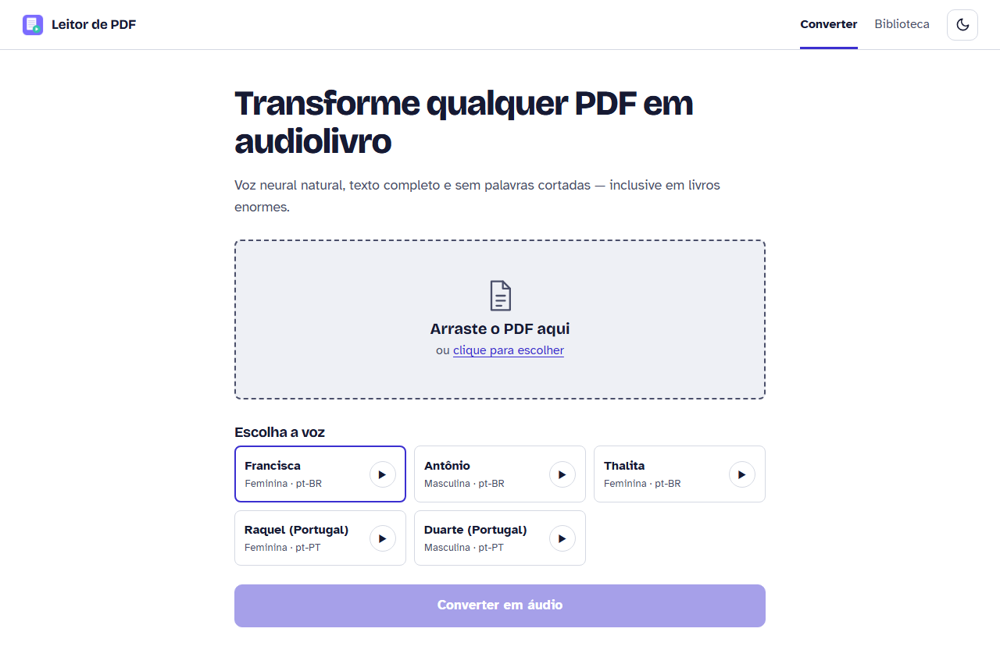
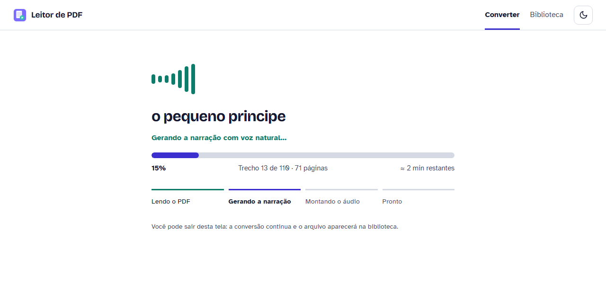

<div align="center">


<br />
<br />

**Converta um PDF em audiolivro com voz natural em português, inclusive livros de milhares de páginas.**

<br />

<a href="https://github.com/valnasio/PDF-TO-AUDIO-CONVERTER/releases/latest/download/LeitorPDF.exe"></a>
&nbsp;
<a href="https://github.com/valnasio/PDF-TO-AUDIO-CONVERTER/releases/latest/download/leitor-pdf_amd64.deb"></a>
&nbsp;
<a href="https://github.com/valnasio/PDF-TO-AUDIO-CONVERTER/releases/latest/download/leitor-pdf.x86_64.rpm"></a>
&nbsp;
<a href="https://github.com/valnasio/PDF-TO-AUDIO-CONVERTER/releases/latest/download/leitor-pdf.flatpak"></a>
&nbsp;
<a href="https://valnasio.github.io/PDF-TO-AUDIO-CONVERTER/app/"></a>

<br />
<br />

<a href="https://valnasio.github.io/PDF-TO-AUDIO-CONVERTER/">Página do projeto</a>

<br />
<br />

<a href="https://github.com/valnasio/PDF-TO-AUDIO-CONVERTER/releases"></a>
<a href="https://github.com/valnasio/PDF-TO-AUDIO-CONVERTER/releases"></a>

</div>

---

## O que é

O Leitor de PDF em Áudio transforma um PDF num audiolivro narrado em português. Você arrasta o arquivo, escolhe a voz e ouve cada página assim que ela fica pronta. A biblioteca guarda os livros convertidos: dá para ouvir o áudio, ler o PDF original e acompanhar o texto enquanto a voz lê.

<p align="center">
  
</p>

## A história do projeto

Comecei este projeto há uns 4 anos, depois de ver um vídeo do canal Hashtag Programação que transformava o texto de uma variável em áudio. Tive a ideia de fazer o mesmo com PDFs: extrair o texto e mandar para um leitor de voz.

A primeira versão era um script de poucas linhas, escrito à mão, com `gTTS` e `PyPDF2`. Você colocava o PDF na pasta, trocava o nome do arquivo no código e rodava. Ela tinha três problemas que eu não resolvi na época:

- Com PDFs grandes, o script cortava o texto em blocos de 9.999 caracteres, partindo palavras e frases no meio, e gerava centenas de MP3 soltos.
- A voz soava robótica e tropeçava em títulos, cabeçalhos e números de página.
- Para usar, você precisava saber programar e instalar o FFmpeg.

O projeto parou aí. Anos depois, voltei a ele com ferramentas de IA para resolver o suporte a PDFs grandes e transformei o script num programa que qualquer pessoa consegue usar.

| | Versão original | Versão atual |
|---|---|---|
| PDFs grandes | Blocos fixos de 9.999 caracteres, palavras quebradas | Divide o texto entre frases e aguenta milhares de páginas |
| Voz | gTTS, robotizada | Vozes neurais no computador ou da Microsoft |
| Resultado | MP3 soltos, sem nome | Um MP3 por página, numa pasta com o nome dos capítulos, e o livro completo |
| Interrupções | Recomeçava do zero | Continua de onde parou |
| Como usar | Editar o código e rodar no terminal | Dois cliques no instalador |

## Telas

<table>
  <tr>
    <td width="50%"></td>
    <td width="50%"></td>
  </tr>
  <tr>
    <td><b>Envio.</b> Você arrasta o PDF, escolhe a voz e ouve uma amostra antes de converter.</td>
    <td><b>Conversão.</b> Mostra a etapa, o percentual e o tempo restante. Você pode ouvir as páginas prontas ou cancelar a qualquer momento.</td>
  </tr>
  <tr>
    <td width="50%"></td>
    <td width="50%"></td>
  </tr>
  <tr>
    <td><b>Player.</b> Velocidade de 0,75x a 2x, ir para uma página, texto destacado conforme a voz lê e download do MP3.</td>
    <td><b>Biblioteca.</b> Seus livros com busca e progresso de escuta. Cada livro abre o player, a pasta de áudios ou o PDF.</td>
  </tr>
</table>

<p align="center">
  <br />
  <sub><b>Áudios por página.</b> Cada página vira um MP3 com o nome do capítulo, por exemplo <code>o-livro/audio004-pag005-capitulo-i.mp3</code>. Você ouve, baixa uma página ou a pasta inteira em .zip.</sub>
</p>

As telas têm modo claro e noturno.

## Como instalar

| | Windows | Linux | Navegador |
|---|---|---|---|
| Download | [`LeitorPDF.exe`](https://github.com/valnasio/PDF-TO-AUDIO-CONVERTER/releases/latest/download/LeitorPDF.exe) (63 MB) | [`.deb`](https://github.com/valnasio/PDF-TO-AUDIO-CONVERTER/releases/latest/download/leitor-pdf_amd64.deb), [`.rpm`](https://github.com/valnasio/PDF-TO-AUDIO-CONVERTER/releases/latest/download/leitor-pdf.x86_64.rpm) ou [`.flatpak`](https://github.com/valnasio/PDF-TO-AUDIO-CONVERTER/releases/latest/download/leitor-pdf.flatpak) (67 MB) | [Abrir no navegador](https://valnasio.github.io/PDF-TO-AUDIO-CONVERTER/app/) |
| Gera MP3 | Sim | Sim | Não, lê em voz alta na hora |
| Vozes | Faber, Cadu e Jeff no computador; Francisca, Antônio e outras da Microsoft | As mesmas do Windows | Faber, Cadu e Jeff no próprio aparelho |
| Onde ficam seus PDFs | No computador | No computador | No navegador, sem envio para servidores |

### Windows

1. Baixe o [`LeitorPDF.exe`](https://github.com/valnasio/PDF-TO-AUDIO-CONVERTER/releases/latest/download/LeitorPDF.exe).
2. Dê dois cliques. O programa abre numa janela própria, sem instalação.
3. Arraste um PDF, escolha a voz e clique em **Converter em áudio**.

> [!NOTE]
> Se o Windows mostrar "O Windows protegeu o computador", clique em **Mais informações** e depois em **Executar assim mesmo**. O aviso aparece porque o programa não tem assinatura digital paga.

### Linux

Escolha o pacote da sua distribuição e abra com dois cliques. A Central de Programas instala o programa e os componentes da janela.

- Ubuntu, Debian, Mint e Pop!_OS: [`leitor-pdf_amd64.deb`](https://github.com/valnasio/PDF-TO-AUDIO-CONVERTER/releases/latest/download/leitor-pdf_amd64.deb)
- Fedora: [`leitor-pdf.x86_64.rpm`](https://github.com/valnasio/PDF-TO-AUDIO-CONVERTER/releases/latest/download/leitor-pdf.x86_64.rpm)
- Outras distribuições: [`leitor-pdf.flatpak`](https://github.com/valnasio/PDF-TO-AUDIO-CONVERTER/releases/latest/download/leitor-pdf.flatpak)

Pelo terminal, na pasta onde está o arquivo:

```bash
sudo apt install ./leitor-pdf_amd64.deb      # Ubuntu e Debian
sudo dnf install ./leitor-pdf.x86_64.rpm     # Fedora
flatpak install --user leitor-pdf.flatpak    # qualquer distribuição com Flatpak
```

O Fedora, o Linux Mint e o Pop!_OS já trazem o Flatpak. No Ubuntu, instale uma vez com `sudo apt install flatpak gnome-software-plugin-flatpak` e reinicie. Na primeira instalação, o Flatpak baixa os componentes do GNOME (cerca de 1 GB), que outros apps Flatpak também usam.

Depois de instalar, procure "Leitor de PDF em Áudio" no menu de aplicativos.

### Navegador

Abra [valnasio.github.io/PDF-TO-AUDIO-CONVERTER/app](https://valnasio.github.io/PDF-TO-AUDIO-CONVERTER/app/), arraste o PDF e aperte o play. O navegador gera as vozes Faber, Cadu e Jeff no seu aparelho com WebAssembly; cada voz baixa uma vez (63 MB) e fica guardada. No Edge, você também encontra as vozes da Microsoft. Se o navegador não conseguir rodar a voz natural, o player usa a voz do próprio navegador.

## Vozes

**No computador (padrão): Faber, Cadu e Jeff.** São vozes neurais do projeto [Piper](https://github.com/OHF-Voice/piper1-gpl). O programa baixa cada uma na primeira vez que você a escolhe (63 MB) e depois converte sem internet e sem limite de páginas. Num computador comum, ele gera a fala cerca de 14 vezes mais rápido que o tempo de leitura: um livro com 40 horas de áudio fica pronto em umas 3 horas.

**Microsoft (online): Francisca, Antônio, Thalita, Raquel e Duarte.** Têm um pouco mais de qualidade e precisam de internet durante a conversão. Em livros muito grandes, o serviço da Microsoft pode recusar pedidos. Quando isso acontece, o programa avisa na tela, diminui o ritmo e tenta de novo. Se o serviço continuar fora por vários minutos, a conversão para com uma mensagem, e você escolhe entre continuar depois ou refazer o livro com uma voz do computador.

## Onde ficam os arquivos

- Áudios: `Músicas\PDFAudioConvert\<livro>` no Windows e `~/Música/PDFAudioConvert/<livro>` no Linux. O botão **Abrir pasta** leva até lá.
- Biblioteca, PDFs e vozes baixadas: `%LOCALAPPDATA%\LeitorPDF` no Windows e `~/.local/share/LeitorPDF` no Linux.

Se você fechar o programa no meio de uma conversão, ela continua de onde parou quando você abrir de novo.

## Como o texto chega inteiro ao áudio

| Problema | O que o programa faz |
|---|---|
| Palavras cortadas | Divide o texto só entre parágrafos e frases. Junta palavras hifenizadas no fim da linha ("pala-/vra" vira "palavra", "disse-lhe" fica igual) e une parágrafos que continuam na página seguinte |
| Leitura estranha | Remove cabeçalhos, rodapés e números de página. Coloca pausa em títulos e nos travessões de diálogo |
| Palavras faltando | Com as vozes Microsoft, compara cada palavra falada com o texto e refaz o trecho incompleto, frase a frase se preciso. Com as vozes do computador, confere a duração do áudio de cada trecho |
| Páginas sem leitura | Gera um áudio por página. No fim, o relatório mostra quantas páginas têm áudio e quais não têm texto, como capas e páginas escaneadas |
| Conversões longas | Salva cada trecho em disco, mantém o Windows acordado durante a conversão e oferece cancelar e continuar depois |

## Limitações

- O programa não lê PDFs escaneados, porque eles não têm texto selecionável. Para isso ele precisaria de OCR.
- Com as vozes da Microsoft, livros muito grandes dependem dos limites do serviço.

## Para desenvolvedores

Requer Python 3.10 ou mais novo.

```bash
python -m venv .venv
.venv\Scripts\activate          # no Linux: source .venv/bin/activate
pip install -r requirements.txt
python main.py                  # abre a janela do programa
python main.py --browser        # abre no navegador
python main.py --server         # só o servidor, sem janela (testes)
```

Opções: `--port 9000` e `--host 0.0.0.0 --browser` para acessar pela rede.

Variáveis de ambiente:

- `PDF_AUDIO_OUTPUT`: pasta dos áudios. No executável, o padrão é `Músicas/PDFAudioConvert`.
- `PDF_AUDIO_DATA`: pasta da biblioteca. O padrão é `./data`; no executável, `%LOCALAPPDATA%\LeitorPDF` ou `~/.local/share/LeitorPDF`.
- `TTS_CONCURRENCY`: quantos trechos o programa pede à Microsoft ao mesmo tempo. O padrão é 6.

### Gerar os instaladores

```bash
.\build.ps1      # Windows: cria dist\LeitorPDF.exe
./build.sh       # Linux: cria dist/leitor-pdf_amd64.deb e dist/leitor-pdf.x86_64.rpm
```

Quando você publica uma tag `v*` (por exemplo, `git tag v2.7.0 && git push origin v2.7.0`), o GitHub Actions gera o `.exe`, o `.deb`, o `.rpm` e o `.flatpak`, testa a instalação no Ubuntu e no Fedora e anexa os arquivos à Release.

### Estrutura

```
main.py              # abre o programa (janela WebView2 no Windows, GTK no Linux)
LeitorPDF.spec       # receita dos executáveis (PyInstaller)
build.ps1, build.sh  # geram os instaladores de Windows e Linux
packaging/linux/     # pacotes .deb e .rpm (nfpm) e atalho do menu
packaging/flatpak/   # pacote Flatpak
.github/workflows/   # build e testes das releases
app/
  main.py            # API (FastAPI)
  pdf_text.py        # extração, limpeza e divisão do texto
  tts.py             # vozes do computador (Piper) e da Microsoft (edge-tts)
  worker.py          # fila de conversão, retomável
  db.py              # biblioteca (SQLite)
  linux_window.py    # janela GTK do Linux
  static/            # interface (HTML, CSS e JS)
docs/                # página de download (GitHub Pages)
  app/               # versão para navegador (pdf.js e Piper em WebAssembly)
```

## Contribuições

Para sugerir uma melhoria, abra uma issue ou envie um pull request.

## Licença

O código deste projeto usa a licença [MIT](LICENSE). Você pode usar, copiar, modificar e distribuir o código, desde que mantenha o aviso de copyright.

### Componentes de terceiros

Os instaladores (`.exe`, `.deb`, `.rpm` e `.flatpak`) incluem estas bibliotecas:

| Componente | Licença | Observação |
|---|---|---|
| [PyMuPDF](https://github.com/pymupdf/PyMuPDF), leitura de PDF | AGPL-3.0 | Quem distribui os instaladores precisa publicar o código-fonte completo, como este repositório faz |
| [piper-tts](https://github.com/OHF-Voice/piper1-gpl) e eSpeak NG, vozes no computador | GPL-3.0 | Mesma exigência de código-fonte público |
| Vozes Faber, Cadu e Jeff ([piper-voices](https://huggingface.co/rhasspy/piper-voices)) | Licenças de cada voz | O programa baixa a voz na primeira vez que você a usa |
| [edge-tts](https://github.com/rany2/edge-tts), vozes Microsoft | LGPL-3.0 | |
| [lameenc](https://github.com/chrisstaite/lameenc), MP3 | LGPL-3.0 | |
| [ONNX Runtime](https://onnxruntime.ai) e NumPy | MIT e BSD-3-Clause | |
| FastAPI e Pydantic | MIT | |
| Starlette, Uvicorn e pywebview | BSD-3-Clause | |
| aiohttp e python-multipart | Apache-2.0 | |
| certifi | MPL-2.0 | |
| Fontes Bricolage Grotesque e Atkinson Hyperlegible | SIL OFL 1.1 | [Detalhes](docs/fonts/LICENSE-fonts.txt) |

As vozes Microsoft usam o serviço de leitura em voz alta do Microsoft Edge, por meio do edge-tts. Este projeto não tem vínculo com a Microsoft.
